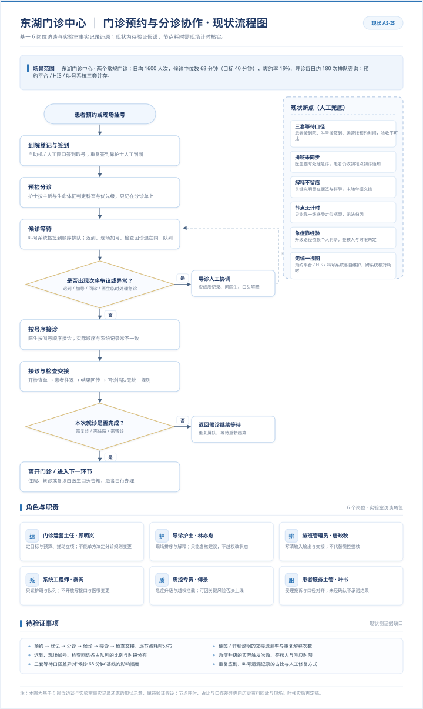
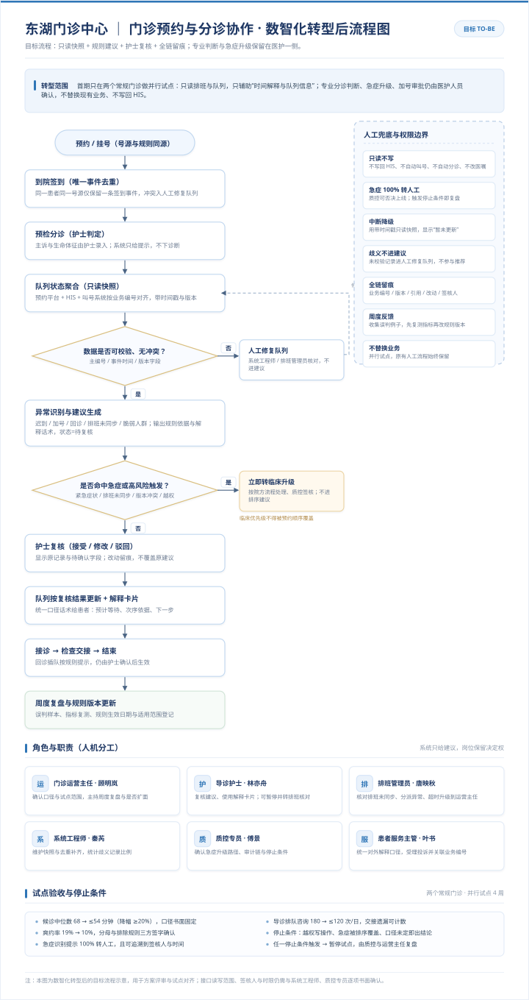

# clinic-triage-copilot · 门诊预约与分诊协作助手（MVP）

> 一句话：**不做自动分诊，只把"谁该先看、为什么、等多久"这三件事讲清楚。**
>
> 一个只读回放式的候诊次序建议原型。它读取门诊预约与叫号的合成数据，按可解释的规则给出**次序建议**，把每一条建议都带上原始记录依据、统一解释口径和人工复核入口。**不写回 HIS，不做诊断，不替医生做决定。**

---

## 1. 这个项目的由来

需求来自 **FDE Discovery Lab（前瞻交付工程师 · 业务挖掘实验室）** 中
「门诊预约与分诊协作」板块的系统化访谈：对门诊运营主任、导诊护士、排班管理员、
门诊系统工程师、医疗质控专员、患者服务主管 **6 个角色做了 35 条事实采集**，
全部事实都有原文证据，可在
[`docs/业务挖掘与需求洞察.md`](docs/业务挖掘与需求洞察.md) 中逐条追溯。

现场最扎心的三句话决定了本项目的形态：

| 角色 | 原话事实 | 编号 |
|---|---|---|
| 门诊运营主任 | 候诊中位数 68 分钟，报告说 25 分钟 —— 目标 40 分钟；爽约率 19%，目标 10% | f00 |
| 导诊护士 | 迟到患者与现场加号混在队列里，护士反复解释次序 | f10 |
| 患者服务主管 | 患者以到院算等待、叫号系统以签到算等待、运营以预约时间算等待 | f50 / f53 |

于是本项目**刻意不做**三件事：**不打通三方系统做实时写入**（事实 f32：只读）、
**不给风险评分**（事实 f40：预约顺序不得置于临床优先级之上）、
**不算"节省了多少医生工时"当现金回款**（事实 f03：收益须扣除维护与人工复核成本）。

## 2. 30 秒跑起来

```bash
git clone https://github.com/<your-account>/clinic-triage-copilot.git
cd clinic-triage-copilot

python -m venv .venv && source .venv/bin/activate      # Windows: .venv\Scripts\activate
pip install -r requirements.txt        # 不装也能跑，这是开发期工具

python -m clinic_triage demo
```

零第三方**运行时**依赖（只用标准库），Python 3.9+ 即可 ——
这是刻意的选择：院内环境装包要过审批，依赖越少越容易进得去。

跑完会在 `out/` 下生成四样东西：

```
out/dashboard.html      单文件看板，双击就能看（无需联网、无外部资源）
out/suggestions.csv     次序建议清单，含每条的依据与解释口径
out/replay.json         回放结果 + 指标，供程序化核对
out/audit.jsonl         审计流水：建议生成即留痕，追加写、不可覆盖
```

想核对数据：`python -m clinic_triage check`
想看某一时刻的队列：`python -m clinic_triage snapshot --at 10:30`
想在浏览器里翻：`python -m clinic_triage serve` → http://127.0.0.1:8765/dashboard.html

一步到位（装依赖 → 造数据 → 画图 → 跑测试 → 出看板）：

```bash
bash scripts/build.sh          # Windows 用 Git Bash，或直接用上面的命令
```

## 3. 四条命令，各自为谁服务

| 命令 | 作用 | 谁用 |
|---|---|---|
| `check` | 数据质量体检：主编号、事件时间、版本字段校验，歧义记录隔离 | 门诊系统工程师（事实 f33） |
| `snapshot` | 打印某一时刻的建议队列，纯文本、可贴进聊天窗口 | 导诊护士快速核对 |
| `demo` | 全量回放，产出看板 / 清单 / JSON / 审计流水 | 门诊运营主任看效果 |
| `serve` | 本地只读预览服务 | 试点现场宣讲 |

## 4. 它到底产出什么

看板打开长这样（三块内容）：

1. **左侧**：队列分带 —— 急症·转人工 / 优先复核 / 让出波次 / 正常排队
2. **中间**：每位患者的建议卡，**必定带"依据"和"给患者的解释口径"**
3. **右侧**：不发生场景下不允许含糊的面板 —— 数据截止时间、人机协作边界、
   转人工触发条件、以及**指标口径差值**（同一批业务三种"等待时间"算出来差多少）

关键取舍：**所有"急诊/待复核"的卡片默认状态是"待人工确认"**，必须有人点确认才流转
（事实 f44：转人工要标注触发原因、接手人和确认时间，不能只给一句模糊提醒）。

## 5. 两张流程图

均由 `scripts/gen_diagrams.py` 生成，SVG 是可再编辑的矢量源文件。

### 现状（AS-IS）



### 数智化转型后（TO-BE）



两张图的差别不在"加了几个系统"，而在**一个节点的位移**：
「解释次序」这件事从**护士凭记忆临时拼凑**，变成**护士照着统一口径念**。
判断权没有移动，移动的只是支撑判断的信息。

## 6. 目录说明

```
clinic-triage-copilot/
├── README.md              你正在看的这个文件
├── LICENSE                Apache-2.0
├── CHANGELOG.md           版本记录
├── CONTRIBUTING.md        贡献与代码规范
├── requirements.txt       依赖清单（运行时零依赖，只剩开发期工具）
├── requirements-dev.txt   可选：ruff / mypy 静态检查
├── src/clinic_triage/     源码
│   ├── __init__.py        版本
│   ├── __main__.py        python -m clinic_triage 入口
│   ├── main.py            CLI：check / snapshot / demo / serve
│   ├── core/              业务逻辑：模型 · 规则 · 队列回放 · 审计
│   └── utils/             工具：配置 · 读写 · 数据质量
├── docs/                  文档
│   ├── 业务挖掘与需求洞察.md     ← Discovery Lab 访谈产出（事实编号可追溯）
│   ├── 行业分析.md / .docx       ← 门诊分诊赛道行业分析
│   ├── 报价单.md / .docx         ← 首期试点报价与设计方案
│   ├── 答辩演示.pptx       ← 23 页答辩稿（原生可编辑）
│   ├── 答辩演讲稿.md / .docx    ← 逐页讲稿，含时间预算
│   ├── design.md          设计说明（为什么长这样）
│   ├── api.md             接口说明（Python API + 数据结构）
│   └── images/            两张流程图 SVG/PNG
├── tests/test_core.py     测试（pytest，32 项）
├── examples/demo.py       可运行示例（自带一小天门诊）
├── scripts/               build.sh / deploy.sh / gen_data.py / gen_diagrams.py / gen_docs.py / gen_ppt.py
├── config/default.yaml    非机密默认参数（所有阈值集中在这里）
├── .github/               CI + Pages 工作流、Issue 模板、PR 模板
└── data/                  合成样例数据（非真实患者）
```

## 7. 边界声明（重要）

| 维度 | 本项目做法 | 依据事实 |
|---|---|---|
| 数据接入 | **只读**排班与队列快照 | f32 |
| 更新频率 | 每天两次授权同步，超时标记"暂未更新" | f34 |
| 断网兜底 | 用带时间戳的上一份快照，按业务编号去重补齐 | f35 |
| 脏数据 | 有歧义记录进人工修复队列，**不进自动建议样本** | f33 |
| 急症 | 一律转人工，禁止以预约顺序覆盖临床优先级 | f40 / f42 |
| 权限 | 只能整理、校核、发起复核；不得代替质控签核 | f22 / f41 |
| 审计 | 留业务编号 + 资料版本 + 事实引用 + 建议 + 人工改动 + 签核人 | f45 |
| 留存 | 评价记录暂留 90 天，期满由质控复核归档或删除 | f43 |

## 8. 验收标准（来自访谈，写死在文档里不是为了好看）

- 两个常规门诊（内科、儿科）并行试点 **4 周**
- 候诊等待时间下降 **20%**（68 分钟 → 目标 40 分钟）
- 急症识别提示 **100% 转人工**，零例由算法直接给出临床结论
- 指标口径三套并存（到院 / 签到 / 预约），**不合并、不美化**（f53）
- 触及任一停止条件立即暂停并由负责人复盘（f42）

## 9. 许可证

Apache-2.0，见 [LICENSE](LICENSE)。

> 本项目使用**合成数据**，`data/appointments.csv` 中所有业务编号、医生和患者信息均为虚构，
> 不涉及任何真实患者数据与隐私。
